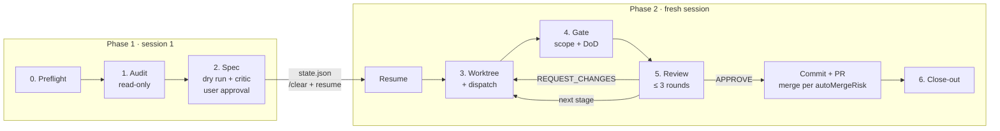

# Spec Ops Pipeline

**English** | [繁體中文](README.zh-TW.md)

[](LICENSE)


Stop letting a single AI agent "quickly fix" things across your repository, touch unrelated
files, and grade its own homework.

**Spec Ops Pipeline** turns codebase audits and multi-file refactoring into a
**disciplined, parallel Lead-Worker pipeline** — giving you **strict file-scope guarantees,
independent code review, parallel subagent speed, and a lean context window** while keeping
your main checkout 100% untouched.

## Table of contents

- [Why](#why)
- [Key benefits](#key-benefits)
- [How it works](#how-it-works)
- [Requirements](#requirements)
- [Installation](#installation)
- [Usage](#usage)
- [Configuration](#configuration)
- [Scripts](#scripts)
- [Project structure](#project-structure)
- [Testing](#testing)
- [Contributing](#contributing)
- [License](#license)

## Why

When one agent both audits and edits your code in a single checkout, changes sprawl across
unrelated files, tests flood the context window, and self-reviews miss subtle regressions.

| Common single-agent pain point | With Spec Ops Pipeline |
| :--- | :--- |
| **Scope creep** — agent edits "just one more file" outside the task | **Hard scope gate** — `check_scope.sh` rejects any change outside the task's file whitelist |
| **Self-grading bias** — the same agent writes and approves its own code | **Strict role separation** — the Lead never edits code; Workers never approve or merge their own work |
| **Dirty working tree** — half-baked edits pollute your active checkout | **Isolated git worktrees** — your main checkout is checksummed before and after, remaining completely untouched |
| **Context bloat & high token cost** — test logs and multi-file edits exhaust context | **Lean context & smart routing** — test outputs are summarized to 1 line, large runs split across sessions, and Workers use faster models |
| **Slow sequential fixes** — fixing 5 issues takes 5× the wall-clock time | **Parallel & staged execution** — independent tasks run simultaneously; dependent tasks run in verified stages |

To enforce this, the skill strictly separates responsibilities:

| Role | May | Must not |
| :--- | :--- | :--- |
| **Lead** (reviewer / orchestrator) | Read and search code, run tests and linters, write specs and reviews, manage worktrees; after your checkpoint approval, commit approved work and open / merge its PR | Edit application files — anywhere; merge a task that was not approved |
| **Worker** (subagent) | Edit files matched by its whitelist, inside its own worktree, until the DoD passes | Touch non-whitelisted files, commit, push, or leave its worktree |

## Key benefits

### 🛡️ Zero unintended blast radius
- **Guaranteed clean main checkout**: The Lead records a cryptographic baseline of your working tree before starting and verifies it at close-out.
- **Enforced file whitelists**: Every task gets an explicit glob whitelist (`<slug>.wl`). `check_scope.sh` blocks committed, staged, unstaged, or untracked changes outside that boundary.
- **Human-in-the-loop control**: Nothing is dispatched until you approve the decision matrix and specs. That one approval also covers the commit, push and PR of every task that passes review; whether the PR is merged for you is your `autoMergeRisk` setting (by default every L/M-risk PR; H-risk PRs are yours to merge). Worktree cleanup always needs your explicit consent.

### 🔍 Higher code quality through adversarial verification
- **Evidence-based read-only audit**: Produces a structured gap report with `file:line`, severity, concrete evidence, and proposed fixes before a single line of code is touched.
- **Pre-flight DoD validation & Plan Critic**: Definition-of-Done commands are dry-run ahead of time to catch broken tests, and complex/high-risk plans are challenged by a read-only Plan Critic before you review them.
- **Bounded independent code review**: Every Worker's diff is verified against its DoD and reviewed line-by-line on the Lead model by a read-only Reviewer subagent whose findings the Lead verifies (capped at 3 rounds before escalating to you, preventing infinite agent loops).

### ⚡ Faster delivery with safe parallelism
- **Concurrent Worker subagents**: Independent tasks run in parallel inside separate git worktrees; dependent tasks run in dependency-ordered stages (`staged` mode), each building on the verified, integrated result of the previous stage.
- **Ready-to-test worktrees out of the box**: Gitignored `.env` / `.env.*` files are automatically copied and `.venv` directories symlinked into every new worktree so test suites work immediately without manual setup.
- **Self-contained Worker context**: Repo rules from `AGENTS.md` / `CLAUDE.md` and project-specific pitfalls are baked directly into each spec so Workers succeed on the first try.

### 💡 Lean context window & lower token costs
- **1-line log compression**: Every test, linter, and build runs through `run_logged.sh`, returning a single summary line (plus log tail only on failure) so verbose test suites never pollute the Lead's context.
- **Two-phase session splitting**: Runs with an H-risk task, three or more tasks, or stages persist state in `<git-common-dir>/sop-run/` and split between planning (Phase 1) and execution (Phase 2), keeping context sharp and focused.
- **Right-sized model routing**: Automatically pairs top-tier reasoning models for Phase 1 auditing/spec-writing with faster, cost-effective models for Phase 2 orchestration and Worker implementation across Claude Code, Codex CLI, and Antigravity.

### 🔧 Zero-config & layout-aware
- **Works with your repo as-is**: Automatically adapts to standard git checkouts and bare-repo worktree layouts (`<root>/.bare` + `<root>/main/`), with optional in-place migration (`migrate_to_bare.sh`, dry-run first + automatic rollback) and root-level agent config symlinks.

## How it works



1. **Preflight** — detect the runtime and worktree layout, check for leftover tasks,
   record a baseline of the Lead's checkout.
2. **Audit** — scan the agreed scope, run existing lint/test/type-check commands, write a
   gap report, and group findings into tasks with small, non-overlapping whitelists.
3. **Spec** — fill a [spec template](skills/spec-ops-pipeline/references/worker-spec-template.md) per task and an
   [execution plan](skills/spec-ops-pipeline/references/execution-plan.md) (`independent` or `staged`). Check
   whitelists for overlap, dry-run every DoD command to catch broken or unreachable ones, and
   for larger or riskier plans have a read-only [Plan Critic](skills/spec-ops-pipeline/references/plan-critic.md)
   challenge the specs. The user gets a decision matrix (scope, risk, shared resources per
   task) ahead of the full specs. **Nothing is dispatched until the user approves.**
   After approval the Lead writes `state.json` to the run dir and ends phase 1: run `/clear`,
   switch to the phase 2 Lead model, and invoke the skill with `resume`. The new session
   checks the baseline and base commit, reads only the plan and the current stage's specs,
   and continues. A small run (one or two L/M-risk tasks, `independent` mode) skips the new
   session and continues right away on the phase 1 Lead model; set `SOP_SESSION_SPLIT=always|never` or say so at
   the checkpoint to change that.
4. **Worktree + dispatch** — create one worktree per task on branch `sop/<slug>` and
   dispatch the stage's Workers in parallel (see [dispatch.md](skills/spec-ops-pipeline/references/dispatch.md)).
5. **Gate** — run `check_scope.sh`, then re-run every DoD command (through
   `run_logged.sh`); all must pass.
6. **Review** — review the diff against the recorded base using the
   [review checklist](skills/spec-ops-pipeline/references/review-checklist.md): a read-only
   Reviewer subagent on the phase 1 Lead model does the review and the Lead verifies its
   findings. On APPROVE the task is committed, pushed and opened as a PR automatically, and the
   PR is merged when `autoMergeRisk` allows it ([rules](#auto-merge-modes)). In staged mode,
   approved tasks are committed locally and merged into `sop-stage/<n>` before the next stage
   starts, and the last stage becomes a single PR; between stages the run stays in the same
   session unless its context has grown large, when the Lead offers a fresh one.
7. **Close-out** — verify the baseline is unchanged, summarise each PR's state, remove
   worktrees, and archive the run dir. Deleting worktrees and the run dir requires explicit
   user consent.

The full procedure lives in [SKILL.md](skills/spec-ops-pipeline/SKILL.md).

## Requirements

- **Bash** and **git ≥ 2.31**
- **python3** (used to read and emit JSON configuration)
- An agent runtime that supports skills and subagents:
  [Claude Code](https://docs.claude.com/en/docs/claude-code), Codex CLI, or Antigravity CLI
- Optional: [Node.js](https://nodejs.org/) ≥ 22 (only for the `npx skills` install)
- [GitHub CLI](https://cli.github.com/) (`gh`), logged in, for the automatic PRs; without it tasks are only committed locally

## Installation

Install with the [`skills` CLI](https://github.com/vercel-labs/skills):

```bash
# Current project: installs to .agents/skills/ and links .claude/skills/ etc.
npx skills add cosmo-chang-1701/spec-ops-pipeline

# All projects: installs to ~/.agents/skills/spec-ops-pipeline and links ~/.claude/skills/
npx skills add cosmo-chang-1701/spec-ops-pipeline -g

# All projects, named agents only (no PromptScript warning)
npx skills add cosmo-chang-1701/spec-ops-pipeline -g -a claude-code

# Pick agents explicitly
npx skills add cosmo-chang-1701/spec-ops-pipeline -a claude-code -a codex

# Preview what would be installed
npx skills add cosmo-chang-1701/spec-ops-pipeline --list

# Update / uninstall
npx skills update
npx skills remove spec-ops-pipeline
```

Only the `skills/spec-ops-pipeline/` directory is installed; the README, LICENSE and
`tests/` stay in the repository.

> **Note**: a global install (`-g`) may print
> `✗ spec-ops-pipeline → PromptScript: PromptScript does not support global skill installation`.
> It is harmless and can be ignored. When `-g` is used without `-a` and the CLI detects
> only one installed agent (or `-y` is passed), it also targets every "universal" agent
> that reads `.agents/skills`. PromptScript is one of them but supports project-level
> installs only, so its install fails. This is `skills` CLI behaviour, not a problem with
> this skill: the skill is still installed to `~/.agents/skills/spec-ops-pipeline`
> and linked into `~/.claude/skills/`. To avoid the line, name the agent(s) explicitly,
> e.g. `-g -a claude-code`. With only `-a claude-code`, the CLI copies the skill straight
> into `~/.claude/skills/spec-ops-pipeline` instead of installing it under
> `~/.agents/skills/` (add more `-a` flags for other agents).

### Manual / development install

The repository root is no longer a skill, so do **not** clone it into
`~/.agents/skills/spec-ops-pipeline` (that is also where `npx skills add -g` writes).
Clone it somewhere else and symlink the skill directory:

```bash
git clone https://github.com/cosmo-chang-1701/spec-ops-pipeline.git \
  ~/src/spec-ops-pipeline

ln -s ~/src/spec-ops-pipeline/skills/spec-ops-pipeline \
  ~/.agents/skills/spec-ops-pipeline
ln -s ~/src/spec-ops-pipeline/skills/spec-ops-pipeline \
  ~/.claude/skills/spec-ops-pipeline
```

<!-- legacy-names:start -->
## Migrating from spec-audit-and-refactor

This project was renamed from `spec-audit-and-refactor` (branch prefix `sar/`, env vars `SAR_*`)
to `spec-ops-pipeline` (branch prefix `sop/`, env vars `SOP_*`). There is no backward compatibility: the new
version does not read any old name. Existing users should:

1. **Finish, or archive and clean up, any run in progress with the old version first.** The new
   version does not recognise `.git/sar-run`, `sar/*` / `sar-stage/*` branches or their worktrees.
   With the old version, run `worktree.sh remove ...` for each worktree and
   `worktree.sh rundir --archive`.
2. **Reinstall**: `npx skills remove spec-audit-and-refactor` (add `-g` if installed globally),
   then `npx skills add cosmo-chang-1701/spec-ops-pipeline` (same flags as before). For a manual symlink
   install, re-point or rename the symlinks to `skills/spec-ops-pipeline`.
3. **Rename** `.agents/spec-audit.json` to `.agents/spec-ops-pipeline.json` in your repos.
4. **Rename** every `SAR_*` environment variable to `SOP_*` (for example `SAR_LEAD_MODEL` becomes
   `SOP_LEAD_MODEL`).
5. **Invoke** the skill as `/spec-ops-pipeline` instead of `/spec-audit-and-refactor`.
<!-- legacy-names:end -->

## Usage

Ask your agent in plain language; the skill triggers on requests such as:

```text
Audit src/auth for security issues and fix what you find.
Delegate this refactor to subagents in separate worktrees.
Run a spec-driven Lead-Worker implementation of the plan in docs/plan.md.
Review the worker's branch sop/fix-token-expiry before merging.
```

A typical run pauses twice for your input: once to agree on audit scope, and once to
approve the gap report, specs and execution plan. One or two L/M-risk tasks then continue in
the same session. For a run with an H-risk task, three or more tasks, or stages, the Lead asks
you to start a fresh session once, and continue with:

```text
/clear
/model sonnet        # the phase 2 Lead model (Claude Code); /effort high
/spec-ops-pipeline resume
```

Your checkpoint approval covers the commit, push and PR of every approved task (and the merge,
per [`autoMergeRisk`](#auto-merge-modes)). Worktree removal is always confirmed with you first.

### Default model assignment

| Ecosystem | Lead · phase 1 (audit, spec) | Lead · phase 2 (dispatch, gate, review) | Worker | Light Worker | Scout |
| :--- | :--- | :--- | :--- | :--- | :--- |
| Claude (Claude Code) | `claude-opus-5-5` · high | `claude-sonnet-5-5` · high | `claude-sonnet-5-5` · medium | `claude-haiku-5-5` · medium | `claude-haiku-5-5` · low |
| Gemini (Antigravity) | `gemini-4-argon-high` · high | `gemini-3.8-flash-high` · high | `gemini-3.8-flash-high` · high | same as Worker | same as Worker |
| Codex | `model` from `~/.codex/config.toml` · high | same as phase 1 | same model · medium | same model · low | same model · low |

Cheaper models go only where the work is simple and checked afterwards:
- **Light Worker** — a task gets it only when it is L-risk, mechanical (rename, dead code,
  lint/type fixes), touches at most 5 files, and has a DoD that can tell fixed from unfixed.
  The tier shows in the checkpoint's decision matrix, and a light task that fails its first
  review is re-dispatched on the Worker model.
- **Scout** — for a large audit scope, read-only scouts sweep it in parallel and return
  `file:line` leads; the phase 1 Lead verifies each lead and does all the judging.
- **Reviewer** — the read-only subagent that reviews each Worker's diff always runs on the
  phase 1 Lead model (in a single-session run the Lead itself already is that model).
- **Plan Critic** — runs on the phase 1 Lead model only when a task is H-risk, otherwise on
  the phase 2 Lead model.

Override with `SOP_LEAD_MODEL`, `SOP_LEAD_EFFORT`, `SOP_LEAD2_MODEL`, `SOP_LEAD2_EFFORT`,
`SOP_WORKER_MODEL`, `SOP_WORKER_EFFORT`, `SOP_WORKER_LIGHT_MODEL`, `SOP_WORKER_LIGHT_EFFORT`,
`SOP_SCOUT_MODEL`, `SOP_SCOUT_EFFORT`. Details: [models.md](skills/spec-ops-pipeline/references/models.md).

## Configuration

No per-repo setup is required — the worktree layout and defaults are detected
automatically:

| | Bare container (`<root>/.bare` + `<root>/main/`) | Standard repo (`.git` in the checkout) |
| :--- | :--- | :--- |
| Task worktree | `<root>/sop/<slug>` | `<parent>/worktrees/<repo>/<slug>` |
| Stage worktree | `<root>/sop-stage/<id>` | `<parent>/worktrees/<repo>/_stage-<id>` |
| Default base | `origin/<default branch>` | `HEAD` |
| Run dir | `<root>/.bare/sop-run/` | `<repo>/.git/sop-run/` |

The run dir (`worktree.sh rundir`) holds the plan, specs, whitelists, logs and `state.json`
of the current run. It sits in the git common dir, so it never shows up as a change, is
shared by all worktrees, and survives a new agent session.

For repos that deviate, add `.agents/spec-ops-pipeline.json`:

```json
{
  "worktreeRoot": "../wt",
  "pathStyle": "slug",
  "defaultBase": "origin/main",
  "provision": { "copy": [".env.local"], "link": [".venv"], "copyMode": "644" },
  "maxParallel": 4,
  "workerNotes": "Run tests with `make test`, never `pytest` directly.",
  "offerBareLayout": false,
  "autoMergeRisk": ["L", "M"],
  "mergeMethod": "squash"
}
```

Settings you want in every repo go in the user config, `~/.config/spec-ops-pipeline/config.json`
(or `$XDG_CONFIG_HOME/spec-ops-pipeline/config.json`; env `SOP_USER_CONFIG` names another file).
It takes the repo-independent keys `autoMergeRisk`, `mergeMethod`, `maxParallel`, `workerNotes`
and `offerBareLayout`; a repo's `.agents/spec-ops-pipeline.json` overrides it key by key.

```json
{
  "autoMergeRisk": ["L", "M"],
  "mergeMethod": "squash"
}
```

<a id="auto-merge-modes"></a>
Every task that passes review gets a PR. `autoMergeRisk` lists the risk levels whose PRs the
Lead then merges (after the PR's checks pass, never with `--admin`, deleting the remote branch
afterwards). The default, `["L", "M"]`, leaves only H-risk PRs to you; `[]` leaves all of them,
`["L", "M", "H"]` none. A PR is merged only if its task was also approved in review round 1 and
not escalated to the stronger Worker model; in `staged` mode the single PR is merged only if
every task qualifies. The older `autoMerge` (`manual`, `low-risk`, `all`) is still read as
`[]`, `["L"]` and `["L", "M", "H"]`.

`mergeMethod` is `squash` (default), `merge` or `rebase`. You can change the list, or a single
task's Merge value, when you approve the checkpoint.

| Environment variable | Effect |
| :--- | :--- |
| `SOP_WORKTREE_ROOT` | Override the worktree root (wins over `worktreeRoot`) |
| `SOP_CONFIG` | Path to a config file to use instead of `.agents/spec-ops-pipeline.json` |
| `SOP_USER_CONFIG` | Path to the user config (default `~/.config/spec-ops-pipeline/config.json`) |
| `SOP_PROVISION=0` | Disable auto-provisioning of `.env` / `.venv` |
| `SOP_BRANCH_PREFIX` | Task branch prefix (default `sop/`) |
| `SOP_STAGE_PREFIX` | Stage branch prefix (default `sop-stage/`) |
| `SOP_ECOSYSTEM` | Force the runtime ecosystem (`claude`, `gemini`, `codex`) |
| `SOP_SESSION_SPLIT` | Fresh session for phase 2: `auto` (default; only for runs with an H-risk task, 3+ tasks or stages), `always`, `never` |
| `SOP_AUTO_MERGE_RISK` | Risk levels to auto-merge, e.g. `L,M`, or `none` (wins over `autoMergeRisk`) |
| `SOP_MERGE_METHOD` | `squash`, `merge` or `rebase` (wins over `mergeMethod`) |
| `SOP_PR_TIMEOUT` | Seconds `pr.sh merge` waits for a PR's checks (default `1800`) |
| `SOP_PR_CHECKS_DELAY` | Seconds before `pr.sh` asks again about a PR with no checks yet (default `20`) |
| `SOP_LOG_TAIL` | Lines of log `run_logged.sh` prints on failure (default `40`) |

See `skills/spec-ops-pipeline/scripts/worktree.sh --help` for the full resolution rules.

## Scripts

All scripts can also be used on their own.

| Script | Purpose |
| :--- | :--- |
| [`detect_runtime.sh`](skills/spec-ops-pipeline/scripts/detect_runtime.sh) | Detect the agent ecosystem and print the phase 1 / phase 2 Lead and Worker models as JSON |
| [`worktree.sh`](skills/spec-ops-pipeline/scripts/worktree.sh) | Layout-aware worktree lifecycle: `config`, `path`, `create`, `integrate`, `remove`, `list`, `status`, `provision`, `rundir` |
| [`run_logged.sh`](skills/spec-ops-pipeline/scripts/run_logged.sh) | Run a command with its output in a log file; print a one-line summary (plus the tail on failure) and keep the exit code |
| [`pr.sh`](skills/spec-ops-pipeline/scripts/pr.sh) | `preflight` / `open` / `merge`: check that PRs can be opened, push a task branch and open (or reuse) its PR, wait for checks and merge it; prints one JSON line |
| [`check_scope.sh`](skills/spec-ops-pipeline/scripts/check_scope.sh) | Fail if any changed file falls outside the whitelist; `--list` / `--overlap` show a whitelist's files and overlaps between whitelists at spec time |
| [`migrate_to_bare.sh`](skills/spec-ops-pipeline/scripts/migrate_to_bare.sh) | Plan (default) or apply an in-place conversion to the bare-repo worktree layout |
| [`wt.sh`](skills/spec-ops-pipeline/scripts/wt.sh) | Everyday branch worktrees in the bare layout — for people, not the Lead; `link-config` re-syncs the agent-config symlinks at the container root |

Whitelist format used by `check_scope.sh`:

```text
src/auth/**          # ** spans directories
src/auth/*.ts        # *  stays within one directory
tests/auth/          # trailing / means the whole directory
!src/auth/secrets.ts # leading ! forbids, overriding positive matches
```

## Project structure

```text
.
├── skills/
│   └── spec-ops-pipeline/ # The skill itself: the only part that gets installed
│       ├── SKILL.md             # Entry point read by the agent
│       ├── references/
│       │   ├── bare-layout.md           # Bare-repo layout and the migration prompt
│       │   ├── dispatch.md              # How to dispatch Workers per runtime
│       │   ├── execution-plan.md        # Dependency analysis, modes, checkpoint report, run state
│       │   ├── models.md                # Models per role, Worker tiers and escalation
│       │   ├── plan-critic.md           # Read-only adversarial review of the specs
│       │   ├── review-checklist.md      # Diff review and verdict format
│       │   ├── scout.md                 # Read-only audit sweeps on a cheap model
│       │   ├── scripts-and-layout.md    # Script exit codes, worktree layout, config overrides
│       │   └── worker-spec-template.md  # Spec handed to each Worker
│       └── scripts/             # Bash helpers (see above)
├── tests/                       # Script tests in throwaway repos (not installed)
├── README.md
├── README.zh-TW.md
└── LICENSE
```

## Testing

The tests create throwaway repositories in a temporary directory, ignore your global and
system git config, and clean up on exit:

```bash
bash tests/worktree_test.sh
bash tests/migrate_bare_test.sh
bash tests/check_scope_test.sh
bash tests/run_logged_test.sh
bash tests/detect_runtime_test.sh
bash tests/pr_test.sh
```

## Contributing

Issues and pull requests are welcome. Before submitting:

1. Keep scripts in Bash with `set -euo pipefail`, matching the existing style.
2. Add or update tests under `tests/` for any script change, and make sure all test
   suites pass.
3. Keep `skills/spec-ops-pipeline/SKILL.md` and the files under
   `skills/spec-ops-pipeline/references/` in sync with script behaviour.

## License

Released under the [MIT License](LICENSE).
