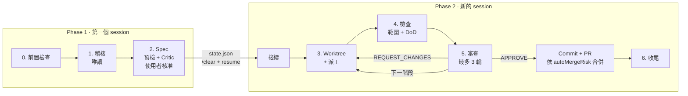

# Spec Ops Pipeline

[English](README.md) | **繁體中文**

[](LICENSE)


別再讓單一 AI agent 在你的 repo 裡「順手修一下」——不僅容易改到不相關的檔案，還自己寫 code 自己審查。

**Spec Ops Pipeline** 將程式碼稽核與跨檔案重構轉化為**嚴謹、可平行的 Lead-Worker 工作流程**：
為你帶來**嚴格的變更範圍保護、獨立的程式碼審查、平行 subagent 的開發速度，以及極致精簡的 context 消耗**，同時確保你原本的工作目錄（main checkout）100% 不受污染。

## 目錄

- [為什麼需要它](#為什麼需要它)
- [使用本專案的好處](#使用本專案的好處)
- [運作方式](#運作方式)
- [系統需求](#系統需求)
- [安裝](#安裝)
- [使用方式](#使用方式)
- [設定](#設定)
- [腳本](#腳本)
- [專案結構](#專案結構)
- [測試](#測試)
- [貢獻](#貢獻)
- [授權條款](#授權條款)

## 為什麼需要它

當同一個 agent 在單一工作目錄中同時負責「找問題」與「改程式碼」時，變更很容易擴散到不相關的檔案、測試輸出會塞爆 context 視窗，且「球員兼裁判」往往會漏掉細微的 regression。

| 單一 Agent 常見痛點 | 使用 Spec Ops Pipeline 的好處 |
| :--- | :--- |
| **變更範圍失控** — agent「順手多改幾個檔案」，改動超出預期 | **嚴格的白名單防線** — `check_scope.sh` 會拒絕任何超出任務白名單的檔案變更 |
| **球員兼裁判** — 同一個 agent 自己寫 code 又自己說沒問題 | **職責徹底分離** — Lead 絕對不改程式碼；Worker 絕對不能自己核准或合併變更 |
| **弄髒工作目錄** — 改到一半的實驗或修補直接污染你正在開發的 checkout | **隔離的 Git Worktree** — 主工作目錄在執行前後都會驗證雜湊基準，全程保持乾淨 |
| **Context 爆炸與高昂 Token 成本** — 大量測試 log 與多檔案修改迅速耗盡 context | **精簡 Context 與智慧模型分配** — 測試輸出濃縮為 1 行摘要、大型任務跨 session 切分，並為 Worker 配置高性價比模型 |
| **循序修改耗時漫長** — 修 5 個問題就得花 5 倍的等待時間 | **平行與分階段執行** — 獨立任務同時平行處理；相依任務則依序分階段整合驗證 |

為了落實這些保障，本 skill 嚴格劃分兩種角色：

| 角色 | 可以 | 不可以 |
| :--- | :--- | :--- |
| **Lead**（審查者／協調者） | 閱讀與搜尋程式碼、執行測試與 linter、撰寫 spec 與審查意見、管理 worktree；經你在 checkpoint 核准後，對通過審查的任務 commit 並開 PR、合併 PR | 在任何地方修改應用程式檔案；合併未通過審查的任務 |
| **Worker**（subagent） | 在自己的 worktree 內修改白名單涵蓋的檔案，直到 DoD 通過 | 修改白名單以外的檔案、commit、push，或離開自己的 worktree |

## 使用本專案的好處

### 🛡️ 零意外波及（絕對的變更邊界與安全性）
- **主工作目錄 100% 不受影響**：Lead 在開始前會記錄主 checkout 的狀態基準（baseline），並在收尾時再次比對確認。之後唯一會做的變動是清理時 fast-forward 到已合併的 PR，而且只在 checkout 沒有未 commit 變更或本機 commit 時進行。
- **強制執行的檔案白名單**：每個任務都有專屬的白名單（`<slug>.wl`），`check_scope.sh` 會攔截任何超出範圍的變更（包含已 commit、已 stage、未 stage 或未追蹤檔案）。
- **關鍵決策由你掌控**：在你核准決策矩陣與 spec 之前，不會派出任何 Worker。這一次核准同時涵蓋每個通過審查任務的 commit、push 與開 PR；是否自動合併 PR 則由 `autoMergeRisk` 設定決定（預設 L/M 風險自動合併，H 風險由你合併）；預設（`autoCleanup`）也涵蓋 PR 合併後的清理。

### 🔍 雙重把關帶來更高品質的程式碼
- **具證據力的唯讀稽核**：動手修改前，先產出包含 `file:line`、嚴重程度、具體證據與修正建議的缺口報告（gap report）。
- **DoD 預檢與 Plan Critic 對抗式審查**：預先 dry-run 所有完成定義（DoD）指令以排除壞掉的測試；多任務或高風險計畫更會先由唯讀的 Plan Critic 進行挑戰，幫你提前抓出規格漏洞。
- **有上限的獨立審查迴圈**：每個 Worker 的修改都必須通過 DoD 檢查，並由唯讀的 Reviewer subagent 以 Lead 模型逐行審查 diff、Lead 再驗證其意見；最多進行 3 輪修正迴圈，超過即交由你裁決，避免 agent 陷入無限重試。

### ⚡ 安全平行化，大幅縮短重構時間
- **多 Worker 同時平行施工**：互相獨立的任務會在各自的 git worktree 中同時執行；有相依性的任務則依序分階段（`staged` 模式）執行，每一階段都建立在前一階段已驗證整合的基礎上。
- **環境自動配置，開箱即可跑測試**：自動將被 gitignore 的 `.env` / `.env.*` 複製到新 worktree，並透過 symlink 連結 `.venv` 虛擬環境，免去手動設定環境的麻煩。
- **內建專案脈絡的 Spec**：自動從 `AGENTS.md` / `CLAUDE.md` 擷取專案規範與常見陷阱寫入 spec，讓沒有共用記憶的 Worker 也能一次做對。

### 💡 極致精簡 Context 視窗並節省 Token 成本
- **單行 Log 濃縮機制**：所有 test、lint 與 build 指令皆透過 `run_logged.sh` 執行，只回傳一行執行摘要（僅在失敗時附上最後幾行 log），避免冗長的測試輸出塞爆 Lead 的 context。
- **兩階段 Session 切分**：含 H 風險任務、3 個以上任務或分階段的流程會將狀態保存在 `<git-common-dir>/sop-run/`，讓規劃（Phase 1）與執行（Phase 2）分開在不同 session 進行，維持最佳推理品質。
- **依任務性質自動分配最佳模型**：自動偵測 Claude Code、Codex CLI 或 Antigravity 環境，在 Phase 1 採用高階推理模型做稽核與規格設計，在 Phase 2 與 Worker 採用快速、高性價比的模型執行實作。

### 🔧 零設定且自動適應 Repo 佈局
- **免設定直接套用**：自動偵測一般 repo 與 bare-repo worktree 佈局（`<root>/.bare` + `<root>/main/`），並提供安全的就地轉換工具（`migrate_to_bare.sh`，先 dry-run、失敗自動 rollback）與根目錄 agent 設定 symlink。

## 運作方式



1. **前置檢查**：偵測執行環境與 worktree 佈局、檢查先前遺留的任務、記錄 Lead checkout 的基準狀態。
2. **稽核**：掃描議定的範圍，執行既有的 lint / test / type-check 指令，撰寫缺口報告，並將發現
   分組為白名單小且互不重疊的任務。
3. **Spec**：為每個任務填寫 [spec 範本](skills/spec-ops-pipeline/references/worker-spec-template.md)，並擬定
   [執行計畫](skills/spec-ops-pipeline/references/execution-plan.md)（`independent` 或 `staged`）。接著檢查白名單是否
   重疊、預先執行每條 DoD 指令以找出無效或無法達成的指令；任務較多或風險較高時，再由唯讀的
   [Plan Critic](skills/spec-ops-pipeline/references/plan-critic.md) 挑戰 spec。呈報時先給使用者決策矩陣（各任務的範圍、
   風險與共用資源），再附完整 spec。**使用者核准前不會派出任何 Worker。**
   核准後，Lead 把 `state.json` 寫入 run dir 並結束 phase 1：執行 `/clear`、切換到 phase 2 的
   Lead 模型，再以 `resume` 呼叫本 skill。新的 session 會先核對基準狀態與 base commit，只讀取
   執行計畫與當前階段的 spec，然後接續執行。小型流程（`independent` 模式下 1–2 個 L/M 風險任務）則不換 session，
   直接以 phase 1 的 Lead 模型繼續；可設定 `SOP_SESSION_SPLIT=always|never`，或在核准時說明來改變。
4. **Worktree + 派工**：為每個任務在 `sop/<slug>` 分支上建立 worktree，並平行派出該階段的
   Worker（詳見 [dispatch.md](skills/spec-ops-pipeline/references/dispatch.md)）。
5. **檢查**：執行 `check_scope.sh`，再透過 `run_logged.sh` 重新執行所有 DoD 指令，全部都必須通過。
6. **審查**：依照[審查清單](skills/spec-ops-pipeline/references/review-checklist.md)，對照記錄的基準審查 diff：
   由 phase 1 Lead 模型的唯讀 Reviewer subagent 進行審查，Lead 再驗證它的意見。APPROVE 後，
   任務會自動 commit、push 並開 PR，`autoMergeRisk` 允許時再合併該 PR（[規則](#自動合併模式)）。
   在 staged 模式下，核准的任務會先在本機 commit 並合併到 `sop-stage/<n>`，才進入下一階段，
   最後一個階段整合成單一 PR；階段之間預設留在同一個 session，只有 context 明顯變大時 Lead 才會提議換新 session。
7. **收尾**：確認基準狀態未變、彙整每個 PR 的狀態。每個已合併的 PR 會移除其 worktree 與本機分支、
   把你 checkout 的分支 fast-forward 到 origin（有未 commit 的變更或本機 commit 時跳過），所有任務
   都清理完後封存 run dir；`autoCleanup`（預設）時自動進行，否則會先詢問。留給你合併的 PR（H 風險）
   會保留 worktree，合併後執行 `/spec-ops-pipeline cleanup` 即可。

完整流程請見 [SKILL.md](skills/spec-ops-pipeline/SKILL.md)。

## 系統需求

- **Bash** 與 **git ≥ 2.31**
- **python3**（用於讀取與輸出 JSON 設定）
- 支援 skill 與 subagent 的 agent 執行環境：
  [Claude Code](https://docs.claude.com/en/docs/claude-code)、Codex CLI 或 Antigravity CLI
- 選用：[Node.js](https://nodejs.org/) ≥ 22（僅 `npx skills` 安裝方式需要）
- [GitHub CLI](https://cli.github.com/)（`gh`，需已登入），用於自動開 PR；沒有的話任務只會在本機 commit

## 安裝

使用 [`skills` CLI](https://github.com/vercel-labs/skills) 安裝：

```bash
# 目前專案：安裝到 .agents/skills/，並連結 .claude/skills/ 等目錄
npx skills add cosmo-chang-1701/spec-ops-pipeline

# 所有專案：安裝到 ~/.agents/skills/spec-ops-pipeline，並連結 ~/.claude/skills/
npx skills add cosmo-chang-1701/spec-ops-pipeline -g

# 所有專案，只針對指定的 agent（不會出現 PromptScript 警告）
npx skills add cosmo-chang-1701/spec-ops-pipeline -g -a claude-code

# 明確指定 agent
npx skills add cosmo-chang-1701/spec-ops-pipeline -a claude-code -a codex

# 預覽將安裝的內容
npx skills add cosmo-chang-1701/spec-ops-pipeline --list

# 更新 / 解除安裝
npx skills update
npx skills remove spec-ops-pipeline
```

只有 `skills/spec-ops-pipeline/` 目錄會被安裝；README、LICENSE 與 `tests/` 只留在
repository 中。

> **注意**：全域安裝（`-g`）可能會印出
> `✗ spec-ops-pipeline → PromptScript: PromptScript does not support global skill installation`。
> 這無害，可以忽略。當使用 `-g` 但未指定 `-a`，且 CLI 只偵測到一個已安裝的 agent（或有加
> `-y`）時，CLI 也會把每個讀取 `.agents/skills` 的「universal」agent 列為目標。
> PromptScript 就是其中之一，但它只支援專案層級安裝，所以安裝失敗。這是 `skills` CLI 的行為，
> 並非此 skill 的問題：skill 仍會安裝到 `~/.agents/skills/spec-ops-pipeline`，並連結到
> `~/.claude/skills/`。若想避免這行訊息，請明確指定 agent，例如 `-g -a claude-code`。
> 只指定 `-a claude-code` 時，CLI 會把 skill 直接複製到 `~/.claude/skills/spec-ops-pipeline`，
> 而不是安裝在 `~/.agents/skills/` 底下（要支援其他 agent 可再加 `-a`）。

### 手動 / 開發安裝

repository 根目錄不再是一個 skill，因此**不要**把它 clone 到
`~/.agents/skills/spec-ops-pipeline`（`npx skills add -g` 也是寫入該路徑）。
請 clone 到其他位置，再以 symlink 連結 skill 目錄：

```bash
git clone https://github.com/cosmo-chang-1701/spec-ops-pipeline.git \
  ~/src/spec-ops-pipeline

ln -s ~/src/spec-ops-pipeline/skills/spec-ops-pipeline \
  ~/.agents/skills/spec-ops-pipeline
ln -s ~/src/spec-ops-pipeline/skills/spec-ops-pipeline \
  ~/.claude/skills/spec-ops-pipeline
```

<!-- legacy-names:start -->
## 從 spec-audit-and-refactor 遷移

本專案已從 `spec-audit-and-refactor`（分支前綴 `sar/`、環境變數 `SAR_*`）更名為 `spec-ops-pipeline`
（分支前綴 `sop/`、環境變數 `SOP_*`）。不提供向後相容：新版不會讀取任何舊名稱。既有使用者請：

1. **先以舊版完成進行中的 run，或將其封存並清理。** 新版不認得 `.git/sar-run`、
   `sar/*` / `sar-stage/*` 分支及其 worktree。以舊版對每個 worktree 執行 `worktree.sh remove ...`，
   再執行 `worktree.sh rundir --archive`。
2. **重新安裝**：`npx skills remove spec-audit-and-refactor`（若為全域安裝請加 `-g`），
   再執行 `npx skills add cosmo-chang-1701/spec-ops-pipeline`（旗標與先前相同）。若是手動 symlink 安裝，
   請將 symlink 重新指向或改名為 `skills/spec-ops-pipeline`。
3. **重新命名**各 repo 中的 `.agents/spec-audit.json` 為 `.agents/spec-ops-pipeline.json`。
4. **重新命名**所有 `SAR_*` 環境變數為 `SOP_*`（例如 `SAR_LEAD_MODEL` 改為 `SOP_LEAD_MODEL`）。
5. **呼叫方式**由 `/spec-audit-and-refactor` 改為 `/spec-ops-pipeline`。
<!-- legacy-names:end -->

## 使用方式

直接用自然語言告訴 agent 即可，例如以下請求都會觸發這個 skill：

```text
稽核 src/auth 的安全性問題，並修正發現的問題。
把這次重構交給 subagent，在各自的 worktree 中進行。
用 spec-driven 的 Lead-Worker 流程實作 docs/plan.md 的計畫。
合併前先審查 worker 的分支 sop/fix-token-expiry。
```

一般流程會停下來等你兩次：一次是議定稽核範圍，一次是核准缺口報告、spec 與執行計畫。
核准之後，1–2 個 L/M 風險任務會直接在同一個 session 繼續；含 H 風險任務、3 個以上任務或
分階段的流程，Lead 會請你開一次新的 session 接續：

```text
/clear
/model sonnet        # phase 2 的 Lead 模型（Claude Code）；/effort high
/spec-ops-pipeline resume
```

你在 checkpoint 的核准涵蓋每個通過審查任務的 commit、push 與開 PR（以及依 [`autoMergeRisk`](#自動合併模式) 的合併），`autoCleanup`（預設）時也涵蓋每個已合併 PR
的清理。你合併完留給你的 PR 後，用以下指令完成清理：

```text
/spec-ops-pipeline cleanup
```

### 預設模型分配

| 生態系 | Lead · phase 1（稽核、spec） | Lead · phase 2（派工、檢查、審查） | Worker | 輕量 Worker | Scout |
| :--- | :--- | :--- | :--- | :--- | :--- |
| Claude（Claude Code） | `claude-opus-5-5` · high | `claude-sonnet-5-5` · high | `claude-sonnet-5-5` · medium | `claude-haiku-5-5` · medium | `claude-haiku-5-5` · low |
| Gemini（Antigravity） | `gemini-4-argon-high` · high | `gemini-3.8-flash-high` · high | `gemini-3.8-flash-high` · high | 與 Worker 相同 | 與 Worker 相同 |
| Codex | `~/.codex/config.toml` 中的 `model` · high | 與 phase 1 相同 | 同一模型 · medium | 同一模型 · low | 同一模型 · low |

較便宜的模型只用在工作單純、事後還會再檢查的地方：
- **輕量 Worker**：任務必須是 L 風險、機械性修改（改名、刪死碼、lint/型別修正）、最多 5 個檔案，
  且 DoD 能分辨修好與沒修好，才會使用。分級會顯示在 checkpoint 的決策矩陣中；第一輪審查沒通過的
  輕量任務，會改用 Worker 模型重新派工。
- **Scout**：稽核範圍很大時，由唯讀的 scout 平行掃描並回傳 `file:line` 線索；phase 1 Lead 會逐一
  驗證線索，所有判斷仍由 Lead 負責。
- **Reviewer**：審查每個 Worker diff 的唯讀 subagent，一律使用 phase 1 的 Lead 模型（單一 session 的流程中，Lead 本身就是該模型）。
- **Plan Critic**：只有在有 H 風險任務時才使用 phase 1 的 Lead 模型，否則使用 phase 2 的 Lead 模型。

可用 `SOP_LEAD_MODEL`、`SOP_LEAD_EFFORT`、`SOP_LEAD2_MODEL`、`SOP_LEAD2_EFFORT`、
`SOP_WORKER_MODEL`、`SOP_WORKER_EFFORT`、`SOP_WORKER_LIGHT_MODEL`、`SOP_WORKER_LIGHT_EFFORT`、
`SOP_SCOUT_MODEL`、`SOP_SCOUT_EFFORT` 覆寫。詳見 [models.md](skills/spec-ops-pipeline/references/models.md)。

## 設定

不需要針對個別 repo 做任何設定，worktree 佈局與預設值都會自動偵測：

| | Bare 容器（`<root>/.bare` + `<root>/main/`） | 一般 repo（checkout 內有 `.git`） |
| :--- | :--- | :--- |
| 任務 worktree | `<root>/sop/<slug>` | `<parent>/worktrees/<repo>/<slug>` |
| 階段 worktree | `<root>/sop-stage/<id>` | `<parent>/worktrees/<repo>/_stage-<id>` |
| 預設 base | `origin/<default branch>` | `HEAD` |
| Run dir | `<root>/.bare/sop-run/` | `<repo>/.git/sop-run/` |

Run dir（`worktree.sh rundir`）存放本次執行的計畫、spec、白名單、log 與 `state.json`。它位於
git common dir 內，所以永遠不會被當成變更、所有 worktree 共用，換了新的 agent session 也還在。

若 repo 有特殊需求，可新增 `.agents/spec-ops-pipeline.json`：

```json
{
  "worktreeRoot": "../wt",
  "pathStyle": "slug",
  "defaultBase": "origin/main",
  "provision": { "copy": [".env.local"], "link": [".venv"], "copyMode": "644" },
  "maxParallel": 4,
  "workerNotes": "Run tests with `make test`, never `pytest` directly.",
  "offerBareLayout": false,
  "autoMergeRisk": ["L", "M"],
  "mergeMethod": "squash",
  "autoCleanup": true
}
```

想套用到所有 repo 的設定，放在使用者設定檔 `~/.config/spec-ops-pipeline/config.json`
（或 `$XDG_CONFIG_HOME/spec-ops-pipeline/config.json`；可用環境變數 `SOP_USER_CONFIG` 指定其他檔案）。
它只讀取與 repo 無關的 `autoMergeRisk`、`mergeMethod`、`autoCleanup`、`maxParallel`、`workerNotes`、
`offerBareLayout`；各 repo 的 `.agents/spec-ops-pipeline.json` 會逐項覆寫它。

```json
{
  "autoMergeRisk": ["L", "M"],
  "mergeMethod": "squash"
}
```

### 自動合併模式

通過審查的任務都會有一個 PR；`autoMergeRisk` 列出 Lead 接著要自動合併哪些風險層級的 PR
（PR 的 checks 通過後才合併，絕不使用 `--admin`，合併後會刪除遠端分支）。預設 `["L", "M"]`，
只有 H 風險的 PR 留給你合併；`[]` 表示全部由你合併，`["L", "M", "H"]` 表示全部自動合併。
任務還必須在第 1 輪審查就通過、且未升級到較強的 Worker 模型，PR 才會自動合併；`staged` 模式下
須每個任務都符合，才會合併那個單一 PR。舊的 `autoMerge`（`manual`、`low-risk`、`all`）仍可使用，
分別視為 `[]`、`["L"]`、`["L", "M", "H"]`。

`mergeMethod` 可設為 `squash`（預設）、`merge` 或 `rebase`。核准 checkpoint 時，你可以更改風險
清單，或只更改單一任務的 Merge 欄位。

`autoCleanup`（預設 `true`）讓 Lead 在 PR 合併後不必詢問就清理：移除任務與階段的 worktree 及其
本機分支（squash 或 rebase 合併的分支也會刪除，前提是 `gh` 確認 PR 已合併）、把你 checkout 的分支
fast-forward 到 origin，沒有剩餘任務時封存 run dir。它絕不使用 `--force`：有未 commit 變更的
worktree 會保留並回報；你的 checkout 有未 commit 的變更或本機 commit 時，會跳過 fast-forward。
設為 `false`，或在核准 checkpoint 時說「不要清理」，就會改為先詢問你。

| 環境變數 | 作用 |
| :--- | :--- |
| `SOP_WORKTREE_ROOT` | 覆寫 worktree 根目錄（優先於 `worktreeRoot`） |
| `SOP_CONFIG` | 指定設定檔路徑，取代 `.agents/spec-ops-pipeline.json` |
| `SOP_USER_CONFIG` | 使用者設定檔路徑（預設 `~/.config/spec-ops-pipeline/config.json`） |
| `SOP_PROVISION=0` | 停用 `.env` / `.venv` 的自動配置 |
| `SOP_BRANCH_PREFIX` | 任務分支前綴（預設 `sop/`） |
| `SOP_STAGE_PREFIX` | 階段分支前綴（預設 `sop-stage/`） |
| `SOP_ECOSYSTEM` | 強制指定執行環境生態系（`claude`、`gemini`、`codex`） |
| `SOP_SESSION_SPLIT` | phase 2 是否換新 session：`auto`（預設；僅含 H 風險任務、3 個以上任務或分階段時）、`always`、`never` |
| `SOP_AUTO_MERGE_RISK` | 自動合併的風險層級，例如 `L,M`，或 `none`（優先於 `autoMergeRisk`） |
| `SOP_MERGE_METHOD` | `squash`、`merge` 或 `rebase`（優先於 `mergeMethod`） |
| `SOP_AUTO_CLEANUP` | `1` 或 `0`（優先於 `autoCleanup`） |
| `SOP_PR_TIMEOUT` | `pr.sh merge` 等待 PR checks 的秒數（預設 `1800`） |
| `SOP_PR_CHECKS_DELAY` | PR 尚無 checks 時，`pr.sh` 再次查詢前等待的秒數（預設 `20`） |
| `SOP_LOG_TAIL` | `run_logged.sh` 失敗時印出的 log 行數（預設 `40`） |

完整的解析規則請執行 `skills/spec-ops-pipeline/scripts/worktree.sh --help`。

## 腳本

所有腳本也都能單獨使用。

| 腳本 | 用途 |
| :--- | :--- |
| [`detect_runtime.sh`](skills/spec-ops-pipeline/scripts/detect_runtime.sh) | 偵測 agent 生態系，並以 JSON 輸出 phase 1 / phase 2 的 Lead 與 Worker 模型 |
| [`worktree.sh`](skills/spec-ops-pipeline/scripts/worktree.sh) | 感知佈局的 worktree 生命週期管理：`config`、`path`、`create`、`integrate`、`remove`、`list`、`status`、`provision`、`rundir`、`sync` |
| [`run_logged.sh`](skills/spec-ops-pipeline/scripts/run_logged.sh) | 執行指令並把輸出寫入 log 檔；只印一行摘要（失敗時附最後幾行），並保留原本的 exit code |
| [`pr.sh`](skills/spec-ops-pipeline/scripts/pr.sh) | `preflight` / `open` / `merge` / `state`：檢查能否開 PR、push 任務分支並開（或沿用）PR、等 checks 通過後合併、查詢 PR 狀態；輸出一行 JSON |
| [`check_scope.sh`](skills/spec-ops-pipeline/scripts/check_scope.sh) | 有任何變更檔案超出白名單時回傳失敗；`--list` / `--overlap` 可在撰寫 spec 時列出白名單涵蓋的檔案與白名單之間的重疊 |
| [`migrate_to_bare.sh`](skills/spec-ops-pipeline/scripts/migrate_to_bare.sh) | 規劃（預設）或執行就地轉換為 bare-repo worktree 佈局 |
| [`wt.sh`](skills/spec-ops-pipeline/scripts/wt.sh) | 在 bare 佈局中管理日常分支 worktree——供人使用，而非 Lead；`link-config` 重新同步容器根目錄的 agent 設定 symlink |

`check_scope.sh` 使用的白名單格式：

```text
src/auth/**          # ** 可跨越多層目錄
src/auth/*.ts        # *  只在單一目錄內比對
tests/auth/          # 結尾的 / 代表整個目錄
!src/auth/secrets.ts # 開頭的 ! 表示禁止，優先於正向比對
```

## 專案結構

```text
.
├── skills/
│   └── spec-ops-pipeline/ # skill 本體：唯一會被安裝的部分
│       ├── SKILL.md             # agent 讀取的進入點
│       ├── references/
│       │   ├── bare-layout.md           # bare-repo 佈局與轉換提問的格式
│       │   ├── dispatch.md              # 各執行環境的 Worker 派工方式
│       │   ├── execution-plan.md        # 相依性分析、執行模式、checkpoint 呈報格式與執行狀態
│       │   ├── models.md                # 各角色的模型、Worker 分級與升級規則
│       │   ├── plan-critic.md           # 對 spec 的唯讀對抗式審查
│       │   ├── review-checklist.md      # diff 審查與判定格式
│       │   ├── scout.md                 # 以便宜模型進行的唯讀稽核掃描
│       │   ├── scripts-and-layout.md    # 腳本 exit code、worktree 佈局與設定覆寫
│       │   └── worker-spec-template.md  # 交給每個 Worker 的 spec 範本
│       └── scripts/             # Bash 輔助腳本（見上方）
├── tests/                       # 在拋棄式 repo 中執行的腳本測試（不會被安裝）
├── README.md
├── README.zh-TW.md
└── LICENSE
```

## 測試

測試會在暫存目錄中建立拋棄式 repository，不讀取你的全域與系統 git 設定，並在結束時自動清理：

```bash
bash tests/worktree_test.sh
bash tests/migrate_bare_test.sh
bash tests/check_scope_test.sh
bash tests/run_logged_test.sh
bash tests/detect_runtime_test.sh
bash tests/pr_test.sh
```

## 貢獻

歡迎提交 issue 與 pull request。提交前請注意：

1. 腳本維持使用 Bash 並加上 `set -euo pipefail`，與現有風格一致。
2. 修改任何腳本時，請在 `tests/` 新增或更新測試，並確認所有測試都通過。
3. 讓 `skills/spec-ops-pipeline/SKILL.md` 與 `skills/spec-ops-pipeline/references/` 下的檔案和腳本行為保持一致。

## 授權條款

本專案採用 [MIT License](LICENSE) 授權。
